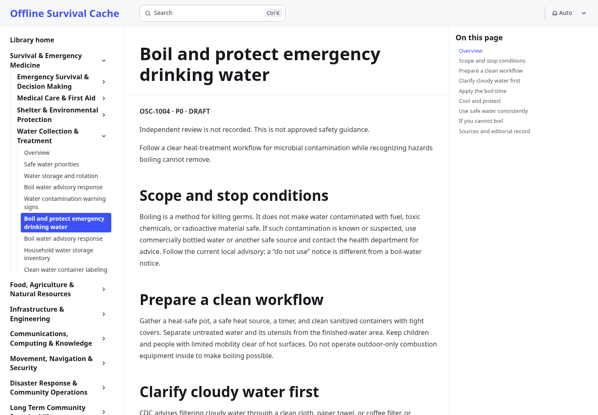

# Reuse-first overhaul: navigation before another redesign

The user rejected the custom dashboard as hard to navigate, clunky and basic. The intended product remains a single offline survival cache combining a personal library, a practical field manual, and an encyclopedia. Another visual reskin of the same custom reader is not the proposed solution.

## Recommended foundation

Use **Starlight/Astro for the reference and field-manual reader**, with its existing navigation, mobile menus, section contents, theme controls, print layout, and Pagefind search. The prototype contains all 109 existing records, including the three preserved originals. Source modules, IDs and review records remain the source of truth; this is an adapter, not another authoring system.

The proposed navigation is library-first: search always available, subjects in a persistent tree, one article in the main column, sections on the right, and a clearly identifiable personal-library destination. Remove the promotional landing screen and statistics from the main reading path. Encyclopedia, field-manual and personal views should share the same navigation rather than become three disconnected apps.

For existing reference material, use curated standard offline collections where appropriate instead of recreating each encyclopedia or repair manual. The official Kiwix catalog returned Appropedia, iFixit and WikiMed entries; the access snapshot is in `existing-collections.json`. Archives were not downloaded or represented as approved. Content rights, provenance, age, geographic applicability and editorial suitability still require assessment before distribution.

## Actual candidates evaluated

| Candidate | Existing capabilities used or documented | Important gap | Result |
|---|---|---|---|
| Starlight 0.42.9 + Astro 7.4.7 (MIT) | Built and tested topic navigation, article reader, native Pagefind passage search, section links and mobile layout | Not a personal-notebook or offline-install engine by itself | Recommended reading foundation |
| TiddlyWiki 5.4.1 (BSD 3-Clause) | Built and tested native search, Markdown reader, editing data model, official browser storage, comments and saved-HTML recovery | Default story-river/authoring UI adds complexity; file/PWA/device workflow needs further work | Useful complete personal-wiki alternative; not recommended as the main interface for the stated complaint |
| Kiwix JS / Kiwix PWA (GPLv3) | Official upstream docs describe mature ZIM reading, archive management and installable offline apps; catalog availability was checked | Personal notebook, unified own-content workflow and licensing/integration are not evaluated | Reuse for compatible archive reading/distribution rather than write a new ZIM reader |
| Material for MkDocs | Official README reviewed | Its README announces end of life on May 5, 2027 and directs new work toward Zensical | Not selected for this rebuild |

Sources: [Starlight](https://github.com/withastro/starlight), [TiddlyWiki](https://github.com/TiddlyWiki/TiddlyWiki5), [Kiwix JS](https://github.com/kiwix/kiwix-js), [Kiwix PWA](https://github.com/kiwix/kiwix-js-pwa), [Material for MkDocs](https://github.com/squidfunk/mkdocs-material).

## Review the real prototypes

The screenshot is upstream Starlight rendering the existing manuscript, not another hand-built reader:

[Mobile reader](starlight-mobile.png) · [Native passage search](starlight-search.png)

Run the reproducible exporter/build/smoke commands in [the evaluation instructions](../../tools/platform-evaluation/README.md). It creates a reading ZIP and an editable TiddlyWiki HTML when the packaging command is run. Production application files, manifests, service workers, dependencies, notes and deployment are not changed by this evaluation.

## Evidence and limits

- Both upstream engines built using all 109 existing article records. Duplicate titles retain distinct IDs; TiddlyWiki retains the full normalized source records.
- Starlight browser checks passed category-to-article navigation, native body-text passage search, mobile navigation availability and no horizontal overflow; no page JavaScript errors were observed.
- TiddlyWiki browser checks passed native article search and manual navigation, official browser-storage note reload, and native saved-HTML restoration with edits in a clean profile and network disabled. The saved artifact was supplied through a test route because this managed browser blocks actual file URLs; native file transport on target devices was not certified.
- Four exporter tests check complete ID coverage, metadata round trips, duplicate-title preservation and literal handling of embedded HTML.
- Kiwix archives were cataloged, not downloaded or tested. No corpus size, content accuracy, approval, or redistribution license is inferred from catalog availability.
- No 3,650-article performance claim is made. The next navigation version must keep the global subject tree small and show current-section articles, rather than render thousands of links on every page. Benchmark with representative real content before cutover.

## Migration gates before replacing production

1. Settle the navigation direction using the real reader, then implement it through framework extension points. Do not build a third custom navigation/search engine.
2. Keep canonical content validation and editorial state. Add external collections with explicit provenance and rights metadata; author genuinely missing guidance rather than duplicate an existing manual.
3. Migrate notebook, bookmarks, annotations and backups through an explicit adapter. Prove restoration of the existing `osc_field_notes_v1` and `osc_workspace_v2` data before retiring their UI. Preserve corrupt or unavailable records for recovery.
4. Use an established offline packaging/caching integration, retaining the existing install until restart, update rollback, cache versioning and user-data tests pass against the new stack.
5. Keep one app experience. TiddlyWiki and Kiwix are evaluation/reference options, not a proposal to make the user navigate three unrelated applications.
6. Cut over only after browser/device validation and feature parity. This PR is a concrete architectural/UI evaluation, not a claim that the full migration is finished.
